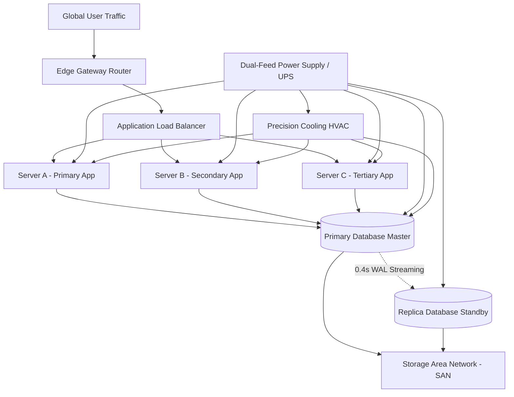

# Autonomous Infrastructure Digital Twin for Predictive Simulation and Resilience Optimization

A modern, responsive web-based digital twin platform designed for enterprise data center infrastructure monitoring, graph-based cascading failure analysis, predictive anomaly detection, and autonomous resilience optimization.

> **Key Innovation:**  
> *"Before making a change or waiting for equipment failure, we simulate it inside the Digital Twin, predict its consequences, evaluate cluster headroom, and autonomously identify the safest response."*

---

## 1. System Architecture & Operational Loop

The platform demonstrates the complete autonomous resilience lifecycle:

$$\text{Real / Simulated Telemetry} \longrightarrow \text{Digital Twin} \longrightarrow \text{Health Monitoring} \longrightarrow \text{Failure Prediction} \longrightarrow \text{Graph Blast Radius Analysis} \longrightarrow \text{What-If Simulation} \longrightarrow \text{Cascading Effect Analysis} \longrightarrow \text{Risk Calculation} \longrightarrow \text{Resilience Optimization} \longrightarrow \text{Autonomous Safe Response}$$



---

## 2. Core Features & Functional Modules

### 1. Main Dashboard
- **Top Infrastructure KPIs**: Total Components (11), Healthy (9), Warning (1), Critical (1), Overall Health (87% Healthy), Active Incidents (3), Predicted Failures (1), Current System Load (55.4%), and Resilience Score (88/100).
- **Continuous Pulse Indicators**: Live telemetry jitter and real-time operational clock.

### 2. Digital Twin Interactive Topology
- High-performance SVG interactive canvas with zoom (70%–140%), panning, status badges (🟢 Healthy, 🟡 Warning, 🔴 Critical, ⚫ Offline), and animated traffic packet pulses.
- Direct upstream feed and downstream consumer highlighting.
- Node inspection modal with real-time gauges, hardware specs, and cascading blast radius calculator.

### 3. Live Infrastructure Monitoring
- Card grid and table views with search and status filters (All, Critical, Warning, Healthy).
- Real-time telemetry: CPU (%), Memory (%), Temperature (°C), Network Traffic (%), Error Rate (%), Power (W), Health Score (0–100), and Failure Probability (0–100%).

### 4. Predictive Failure Detection Engine
- Transparent multi-sensor anomaly scoring:
  $$\text{Risk} = 0.28 \cdot \text{Temp} + 0.27 \cdot \text{CPU} + 0.22 \cdot \text{ErrRate} + 0.13 \cdot \text{Traffic} + 0.10 \cdot \text{Mem}$$
- Risk Tiers: Safe (0–20%), Warning (21–50%), High Risk (51–75%), and Critical (76–100%).
- AI-generated diagnostic narratives explaining exact telemetry triggers (e.g. Server A thermal runaway).

### 5. What-If Scenario Simulator (Core Feature)
- Virtual sandbox execution:
  - **Simulate Server A Failure** (detaches node inside Twin with zero production downtime).
  - **Simulate 50% Traffic Ingress Surge**.
  - **Simulate Primary Database Crash** (evaluating replica failover).
  - **Simulate Precision Cooling Failure**.
- Side-by-side **Before vs. Simulated Event vs. Predicted Impact**:
  - Before: Server A Critical (86% CPU, 74°C).
  - Simulated Event: Server A $\rightarrow$ OFFLINE.
  - Predicted Impact: Server B Load $\rightarrow$ 82%, Server C Load $\rightarrow$ 79%, DB Load $\rightarrow$ 71%.
- **Automatic Headroom Validation**: Verifies surviving cluster nodes can safely handle redirected load below 85% ceiling.
- **Recommended Action**: 🟢 *"Redirect Server A traffic evenly across Server B (50%) and Server C (50%)."*

### 6. Scenario Comparison Matrix
- Side-by-side comparison of remediation strategies:
  - **Option A (Do Nothing)**: Risk 89%, 15–45 min ungraceful outage.
  - **Option B (Shift to Server B only)**: Risk 68%, Server B overloaded at 98%.
  - **Option C (Dual Balanced Distribution)**: Risk 18%, 0s hitless transition, Server B at 82%, Server C at 79% (**Safest Recommended Action**).

### 7. Database Replication & Standby Availability
- Real-time replication tracking: Master OLTP vs Hot-Standby Replica, 0.4s WAL replication latency, zero data loss (RPO=0), and sub-12s automated failover readiness.

### 8. Risk Heatmap & Incident Management
- Visual risk matrix triaging all nodes into Critical, Warning, and Safe tiers.
- Filterable incident management log (`INC-001`, `INC-002`, `INC-003`) with severity badges and telemetry triggers.

### 9. Historical Telemetry Analytics
- Interactive multi-line Recharts across CPU, Temperature, Traffic, Error Rate, Power, and Risk Score.
- Timeframe filters: Last 1 hour, 6 hours, 24 hours, 7 days.

### 10. Autonomous Recommendation Engine
- AI-style remediation cards with expected percentage reduction in load and one-click "Simulate in Twin" action.

### 11. Simulation Audit Report Generation
- Comprehensive audit report modal with resilience score deltas (72% $\rightarrow$ 88%), cascading propagation path, and browser Print / PDF / JSON download.

### 12. 10-Step Guided Demo Tour (Judge Mode)
- Built-in presentation controller guiding hackathon judges step-by-step through the problem narrative:
  1. Normal Infrastructure (Health 94%)
  2. Detect Telemetry Warning (Server A spikes, Failure Prob 87%)
  3. Open Digital Twin Topology
  4. Select "What if Server A fails?"
  5. Virtual Simulation Execution (Zero real outage)
  6. Graph-Based Cascading Analysis
  7. Load Redistribution & Headroom Check (Server B 82%, Server C 79%)
  8. Risk Calculation & Scenario Comparison (Risk: Low 18%)
  9. Autonomous Action Recommendation
  10. Resilient Infrastructure Continuity

---

## 3. Technology Stack

- **Backend**:
  - Python 3.11
  - FastAPI + Uvicorn (Asynchronous REST API + Background Ticker)
  - NetworkX (Directed Dependency Graph & Blast Radius Solver)
  - SQLite (Persistent Telemetry History, Incidents, & Simulation Audit Logs)
  - Pydantic v2 (Strict Schema Contracts)
- **Frontend**:
  - React 18 + TypeScript + Vite
  - Tailwind CSS (Dark Cyber-Ops Enterprise Theme)
  - Lucide React (Enterprise Iconography)
  - Recharts (Interactive Time-Series Analytics)
  - Responsive SVG Canvas (Interactive Digital Twin Topology with Directed Bezier Flows)

---

## 4. Quick Start Guide

### Option 1: One-Click Startup (Recommended)
Double-click `run.bat` or execute in PowerShell:
```powershell
.\run.ps1
```
This automatically launches:
- **FastAPI Backend**: `http://localhost:8000` (API documentation at `http://localhost:8000/docs`)
- **React Web App**: `http://localhost:5173`

### Option 2: Manual Startup

**Terminal 1 — Backend:**
```powershell
cd backend
python -m uvicorn app:app --host 0.0.0.0 --port 8000 --reload
```

**Terminal 2 — Frontend:**
```powershell
cd frontend
npm run dev
```

Open `http://localhost:5173` in your browser.

---

## 5. Demonstration Flow for College / Hackathon Judges

1. Open `http://localhost:5173` and click the **"Judge Demo Tour"** button in the top navigation bar.
2. Step through the 10-step tour:
   - **Step 1**: Baseline state is healthy.
   - **Step 2**: Observe early warning anomaly detection on Server A (Failure Risk: 87%).
   - **Step 3**: Inspect Digital Twin topology; notice glowing critical indicators and dependency linkages.
   - **Step 4 & 5**: Run What-If Simulator: Server A is virtually detached inside the Twin without any real-world downtime.
   - **Step 6 & 7**: Inspect cascading load redistribution (Server B at 82%, Server C at 79%).
   - **Step 8**: Review the Scenario Comparison Matrix to verify why balanced failover is the safest option.
   - **Step 9 & 10**: Observe the autonomous recommendation and export the simulation report as a PDF!
# Infrastructure-Digital-Twin

